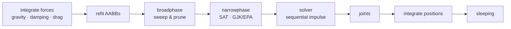

# omi_physics

A renderer-agnostic, real-time **rigid-body physics engine** for Python, built
natively on the [OMI glTF physics](https://github.com/omigroup/gltf-extensions)
data model. State lives in flat NumPy arrays, the whole step pipeline is
vectorized, and optional compiled Cython accelerators drop in transparently for
the hot paths (the contact solver and box/sphere collision).

- **NumPy is the only hard dependency.** No graphics library is required to
  simulate.
- **PyOpenGL is optional** — used solely by the experimental GPU compute backend
  (`omi_physics.glcompute`).
- **Deterministic** on the CPU backend: the same inputs produce the same
  trajectory, run to run.
- **Fast**: sweep-and-prune broadphase, SAT/GJK narrowphase, an island-parallel
  sequential-impulse solver, sleeping, and a background-threaded simulation loop
  that overlaps with a consumer's render/IO thread.

> ⚠️ **This code is largely LLM-written.** It has a test suite and the CPU
> backend is deterministic, but it comes with **no guarantees** of correctness,
> accuracy, or fitness for any purpose (see [`LICENSE`](LICENSE), MIT). Review it
> before relying on it for anything that matters.

## Install

```bash
pip install omi_physics            # core engine (NumPy only)
pip install "omi_physics[gl]"      # + PyOpenGL for the GPU compute backend
```

Prebuilt wheels ship the compiled accelerators, so no C compiler is needed. A
source install without a compiler still works — the engine falls back to the
identical pure-NumPy code paths.

## Quick start

```python
import numpy as np
from omi_physics import PhysicsWorld, model

world = PhysicsWorld(gravity=model.Gravity(gravity=9.81, direction=(0, -1, 0)))

# A static ground box and a dynamic box that falls onto it.
ground = world.add_shape(model.Shape.box((20, 1, 20)))
box    = world.add_shape(model.Shape.box((1, 1, 1)))
wood   = world.add_material(model.Material())

world.add_body(model.Motion(type=model.STATIC),
               collider=model.Collider(shape=ground, physicsMaterial=wood),
               position=(0, 0, 0))
falling = world.add_body(model.Motion(type=model.DYNAMIC, mass=1.0),
                         collider=model.Collider(shape=box, physicsMaterial=wood),
                         position=(0, 5, 0))

for _ in range(120):                       # 2 seconds at 60 Hz
    world.step(1 / 60)

print(world.position[falling])             # resting on the ground
```

> The exact `add_body`/`add_shape` signatures are the source of truth in
> [`world.py`](src/omi_physics/world.py); see the tests for worked examples.

### Off-thread simulation

`ThreadedSimulation` steps the world on a daemon thread and publishes an
immutable pose snapshot each tick. A renderer reads the latest snapshot every
frame without ever blocking on the solver:

```python
from omi_physics.threaded import ThreadedSimulation

sim = ThreadedSimulation(world, sim_hz=120)
sim.start()
# ... each render frame:
snapshot, version = sim.latest()           # (position, axis_angle, awake, dynamic)
# ... on shutdown:
sim.stop()
```

Any thread talks to the world through the thread's command inbox. A command is
a function of the world; it runs on the simulation thread at the start of the
next tick, before that tick's step, in the order it was queued:

```python
sim.post(lambda world: world.apply_impulse(ball, (0, 5, 0)))   # no answer
future = sim.call(lambda world: world.live_body_count)          # a concurrent.futures.Future
```

While no dynamic body is awake, no kinematic body is moving, the world holds no
joint and the inbox is empty, the thread blocks instead of ticking, so a scene
at rest costs no CPU. `post`, `call`, leaving `with_world()` and `wake()` end
the wait; `stop()` interrupts it. A change made any other way to a world at
rest, such as `place_body` on a kinematic body, needs a `wake()`. No steps run
while idle, so step hooks and `world.time` stand still too;
`ThreadedSimulation(world, block_when_idle=False)` ticks regardless.

`PhysicsWorld.add_step_hook(before=None, after=None)` calls `before(step)` ahead
of every fixed step and `after(step)` behind it, on whichever thread steps the
world. `step` is a `Step` of `dt`, `index` (the `step` its contact events
carry) and `time`. The call returns a function that removes the hooks.

## How it works

One `world.step(dt)` runs this fixed-timestep pipeline over the world's
structure-of-arrays state:



The data model is OMI glTF physics (`model.Shape`, `Motion`, `Collider`,
`Material`, `Joint`, ...), so scenes round-trip to and from glTF documents
(`omi_physics.omi_gltf`).

### How hard something was hit

`world.impact_on(body)` answers what struck a body in the step just run and how
fast the two were closing along the contact when they met, in metres per second
— the number damage, a crash, an impact sound or a jolt of force feedback is
decided from.

```python
for _ in range(steps):
    world.step(1 / 120)
    struck = world.impact_on(player, above=1.0, skip_static=True)
    if struck is not None:
        other, closing = struck
        crunch(closing)
```

**Ask once a step, not once a frame.** A frame is several steps, contacts are
rebuilt in each of them, and the speed on a contact is taken *before* the solve
— because resolving a contact is precisely cancelling the velocity that measures
it. Sampled a step late, a square-on impact reads as nothing while a glancing
one reads almost undiminished, which is the wrong way round for anything that
has to tell a crash from a scrape.

`above` is the speed below which a contact is not a blow. A body held against
something is closing on it slightly on every step: over one step gravity gives
it `g·dt` for the solver to take away again, so a box resting on the floor at
120 Hz reads about 0.08 m/s for as long as it sits there. `skip_static` leaves
out what a body landed on, for a caller that wants to know what it *hit*.

A body the game moves itself has to be told its velocity as well as its pose
(`place_body`, then a write to `linear_velocity`). Without one it is a wall:
the solver resolves against the difference between two bodies' velocities, so a
moving platform written down as still throws off whatever lands on it and reads
as having been hit at the full speed of anything that merely caught it up.

### Being told when things touch

`impact_on` answers about one step. A game that advances the world once a frame
with `advance(real_dt)` runs several steps per frame, and a bounce that begins
and ends inside a frame is gone by the time the frame asks. The world can
instead record contact **events** on every step: one per touching pair, not one
per manifold point, with a phase of `'begin'`, `'persist'` or `'end'`.

```python
from omi_physics.contactevents import Verdict

def on_contact(event):                  # called inside step(), after the solve
    if event.phase == 'begin' and event.approach > 1.0:
        thud(event.point, event.approach)

world.add_contact_listener(on_contact)  # switches contact_reporting to 'all'

# or record them and read them once a frame, on whichever thread draws
world.contact_reporting = 'flagged'
world.report_contacts(crate)            # only pairs involving flagged bodies
world.advance(frame_time)
for event in world.contact_log.drain():
    ...
```

A `ContactEvent` carries the pair as `a` and `b` (`a.index < b.index`), a
`point` and a `normal` from `a` to `b`, `approach` (the closing speed
`impact_on` compares, in m/s), `impulse` (the sum of the normal impulses, in
N·s, which is what a breaking strength compares against), `friction_impulse`,
`slip` (sliding speed, m/s), `depth`, the number of `points`, and the `step`
and `time` it happened at. An `'end'` carries a `reason`: `'separated'`, or
`'removed'` when one body was taken out with `remove_body`.

- `contact_reporting` is `'off'` (the default, and no cost), `'flagged'` or
  `'all'`. Reporting every pair of a resting pile of 300 boxes adds about 2%
  to its step. `world.reports_pair(a, b)` is whether the setting records the
  pair of body indices `a` and `b`.
- `report_persist` adds a `'persist'` event for every touching pair on every
  step, and a `'stay'` for every trigger overlap. Off, a pair is still tracked
  and only its `'begin'` and `'end'` are reported.
- Two bodies that fall asleep against each other stay touching: a crate that
  settles on the floor gets a `'begin'` and no `'end'` until something moves
  it off.
- Trigger overlaps go into the same log as `TriggerEvent(phase, trigger, other,
  step, time, point)`, in step order with the contacts; `point` is where
  `other` was when the overlap was tested. A trigger's
  `collisionFilter` says which bodies it reacts to.
- Bodies are named by `BodyRef(index, generation)`. `world.ref(i)` makes one,
  `world.alive(ref)` says whether that body is still in the world, and
  `world.handle_of(ref)` returns the `handle` it was added with. A removed
  body's slot is reused, and a reference to the old body never matches the new
  one.
- The log is bounded (`ContactLog(maxlen=65536)`) and counts what it discarded
  in `dropped`. A world whose events go only to its listeners sets
  `world.log_events = False`, and the log stays empty. Under
  `ThreadedSimulation`, `latest_and_events()` returns the newest snapshot with
  every event up to it, and `flush_events()`, called under `with_world()`,
  publishes the events a removal logged without waiting for the next tick.
  `with_world()` is re-entrant.
- A listener runs inside the step. One that raises does not stop it: the other
  listeners are still called, the step (or `remove_body`) finishes, and the
  first exception is raised from `step()` once it has.
- `ContactEvent.point` and `normal` are arrays each event owns.

A walking character has a body in the world when it is built with
`CharacterController(world, ..., body=True)`. The body is a *sensor*
(`add_body(..., sensor=True)`, `world.is_sensor(i)`): a kinematic capsule that
follows the character, enters trigger volumes, and has its touches with moving
bodies reported as contact events with `solved=False`. Nothing is solved
against a sensor, so it pushes no crate and no crate pushes it, and rays pass
through it. The controller still collides the character with the static world
itself, and while the world records contacts it reports what the capsule
begins and stops touching there (within 2 cm), with the speed it arrived at,
through `world.report_contact_events`.

`set_contact_filter(fn)` decides about a pair **before** it is solved, on the
step it would begin. `fn` receives a `PairPreview` (the pair, `approach`, the
reduced `mass` and the `impulse` the blow carries) and returns
`Verdict.SOLVE`, `Verdict.IGNORE_STEP` or `Verdict.IGNORE_PAIR`. A pane of
glass that breaks under the blow answers `IGNORE_PAIR`, and the ball carries on
through with its momentum; the pair's events arrive with `solved=False`.
Under `'flagged'` reporting, a pair whose bodies are both unflagged is no
longer tracked, and its verdict is dropped with it: flagged again, the filter
is asked about it afresh.

### Character states, slides and moving bodies

`CharacterController.state` is a `CharacterState`: `STANDING`, `CROUCHING`,
`SLIDING`, `AIRBORNE`, `DOWN`, `SWIMMING` or `FLYING`. When several hold, the
first of `FLYING`, `SWIMMING`, `DOWN`, `AIRBORNE`, `SLIDING`, `CROUCHING`
wins.

- `slide(duration, rise=0.3)` starts a slide from the ground and returns whether
  it began. The character keeps the speed it had, input is ignored, and
  `pushFriction` bleeds the speed off. The capsule is `crouchHeight` tall until
  the last `rise` seconds, then grows to `standHeight` with its feet in place.
  Under a ceiling that leaves no room the rise waits, and the slide ends
  crouched. `slide(duration, steer=True)` takes no momentum and no friction:
  the input still moves the character, at the speed of its mode and not the
  crouch's. `extend_slide(duration)` gives a slide that long again from now, with
  the capsule low again, and returns whether there was a slide; `end_slide()`
  ends one at once and stands, or crouches where there is no room. A slide that
  is gone on with keeps `slide_progress` where the capsule is low, however long it
  lasts, and goes through the rise over its end.
- `jumpFollowsSlope` in `CharacterCapabilities` (default false) adds the vertical
  speed of the run along the ground to a jump's launch speed, so a jump off a
  falling slope rises `jumpHeight` above the ground and not above the point it
  left.
- `knock_down()` lowers the capsule to `crouchHeight`, ignores input and sets
  the speed to zero. Gravity still acts and `jump()` is refused. `get_up()` ends
  it; `get_up(start_speed=4.0)` also carries 4 m/s along the last direction the
  character was told to move in, bled off by `pushFriction`.
- `landing` is the downward speed in m/s of the step that put the character on
  the ground during the last `update`, and None for an update that did not.
- Gravity is integrated exactly (`v dt - g dt^2 / 2`), so a jump of
  `jumpHeight` rises exactly that far and lands after `2 sqrt(2 h / g)` at any
  frame rate.

The controller reads the world through the `CollisionQuery` protocol
(`omi_physics.collisionquery`): `static_bodies()`, `static_near(lo, hi)` (the
fixed bodies whose boxes overlap a box), `static_proxy(body)`,
`dynamic_near(lo, hi)` (a list of `DynamicBody` with shape, pose, velocity and
mass) and `raycast(...)`. `WorldQuery(world)` answers it from a live
`PhysicsWorld`, which `CharacterController(world, ...)` builds itself; an
immutable copy of the colliders can answer it instead. `body=True` needs a
`PhysicsWorld`. `ignore=[...]` lists bodies the capsule does not collide with.

A capsule among triangle meshes alone, with no dynamic body near, is collided
with the triangles near it as numbers (`collide.upright_capsule_mesh_pushes`,
compiled where the accelerator is built), and its poses are those of the proxy
path to the bit.

Dynamic bodies are obstacles and floors for the capsule, read once at the start
of each `update`:

- A body of at most `pushMass` kilograms (default 200) that the capsule is
  within `PUSH_REACH` (0.05 m) of, in the way of its step, is named in
  `pushing` as `(body, velocity)`. The velocity is the one the step wanted,
  limited to `pushSpeed` (default `walkSpeed`). The caller gives that velocity to
  a kinematic stand-in body placed at the character, wider than the capsule by
  at most `PUSH_REACH` so it overlaps what the capsule touches, and the solver
  moves the body. The solver treats a kinematic body as infinitely heavy, so it
  would move a crate of any weight; a stand-in needs a `set_pair_rule` that skips
  bodies heavier than `pushMass`. Those block the capsule like a wall.
- `standing_on` is the id of the dynamic body underfoot, which carries the
  character by its velocity.
- `knockback(impulse)` adds `impulse / mass` (`mass` is 80 kg by default) to the
  velocity; an upward part leaves the ground.

### What a line meets

`omi_physics.raycast` answers what a ray, a line of sight or a bundle of rays
meets among the world's colliders. Sensors are passed through.

```python
from omi_physics import model
from omi_physics.raycast import bodies_along, line_of_sight, raycast, raycast_many

hit = raycast(world, origin, direction, max_distance=100.0, skip=(shooter,))
if hit is not None:
    spark(hit.point, hit.normal)        # the normal faces back along the ray

team_shot = model.CollisionFilter(collisionSystems=('shot',),
                                  notCollideWithSystems=('red',))
hit = raycast(world, origin, direction, filter=team_shot)
```

- `raycast` returns the nearest `RayHit` (`body`, `distance`, `point`,
  `normal`, and on a trimesh the `triangle` index), or None. The direction
  need not be normalised.
- `bodies_along` returns every hit, nearest first; `line_of_sight(world, a, b)`
  says whether nothing lies between two points.
- `raycast_many(world, origins, directions)` casts a bundle together and
  returns what each ray would have answered on its own. The rays of a bundle
  are tested against the triangles near the box the whole bundle sweeps, in
  one pass of `rays × triangles`, so its temporary arrays grow with both: a
  bundle spread across a level over a dense mesh is better cast as several.
- `skip` names bodies the ray passes through. `filter` is a
  `model.CollisionFilter` for the ray itself: it meets only bodies whose
  collider's filter it collides with, in the same terms as two colliders.
  `raycast_many` and `bodies_along` take both as `raycast` does.

### Shapes in pieces, cylinders and cones

A body's collider is one shape, and `Shape.compound` makes one shape of
several, each placed in the body's frame. The body's origin is where its mass
is, so a part placed away from the origin is a shape hung off-centre; a
compound's mass is shared among its parts by volume.

```python
from omi_physics import model

hammer = model.Shape.compound([
    model.ShapePart(model.Shape.box((0.1, 0.1, 0.8)), position=(0.0, 0.0, 0.25)),
    model.ShapePart(model.Shape.box((0.3, 0.12, 0.12)), position=(0.0, 0.0, -0.2)),
])
cone = model.Shape(type='cylinder', height=1.0, radiusBottom=0.5, radiusTop=0.0)
```

A `cylinder` has flat ends and narrows from `radiusBottom` to `radiusTop`;
zero at either end is a cone. A ray meets each part, side and end exactly. A
triangle mesh is for what does not move: two meshes make no contacts with
each other, so a moving body is given a convex shape.

### Height fields

`Shape.heightfield` is a static ground `y = h(x, z)` in the body's frame, local
+Y up, with everything below the surface solid. It comes in two forms:

```python
# A regular grid: heights[j, i] is the height at x = origin[0] + i * spacing,
# z = origin[2] + j * spacing, added to origin[1]. Bilinear, with the exact
# slope of the cell as its normal. The grid is the extent.
land = model.Shape.heightfield(heights, origin=(-500.0, 0.0, -500.0), spacing=2.0)

# A function, for a landscape too large for a grid or one a renderer already
# samples. In-process only; not written to glTF.
land = model.Shape.heightfield(sample=terrain.height, normal=terrain.normal,
                               extent=((-4000, -4000), (4000, 4000)),
                               feature=2.0, vectorized=True)

ground = world.add_body(model.Motion(type=model.STATIC),
                        collider=model.Collider(shape=world.add_shape(land)))
```

Spheres, capsules, cylinders, boxes and convex hulls collide with it, and rays
hit it. `sample(x, z)` is called with floats, or with arrays of one shape when
`vectorized=True`. Without `normal` the normal is the central difference of
`sample` over `delta` (1e-3). `extent` is `((x_min, z_min), (x_max, z_max))`
and None reaches every `(x, z)`; `height_range=(lowest, highest)` bounds the
body in y for the broad phase, which an unbounded field cannot be.

- Nothing exists outside the extent: a ball rolling off the edge falls. The
  surface has no sides, so a ray entering the extent sideways below the
  surface passes through, while a ray that starts below the surface inside
  the extent hits it at distance 0.
- Depth is measured along the surface normal, the distance to the tangent
  plane, so a steep slope pushes a body out by the depth it is in.
- A sphere finds the nearest ground by sliding down the tangent plane from the
  point beneath its centre; a capsule is spheres along its axis. A box,
  hull or cylinder is tested by its vertices (a cylinder by 24 points around
  each end) and by ground rising into its footprint between the vertices,
  sampled every `feature` units, at most 7 samples a side. A ground feature
  narrower than `feature` and a box wider than 7 features can be missed
  between samples; set `feature` to the size of the smallest bump that
  matters.
- A character among height fields alone, with no moving body near, is
  collided with them with numbers: its capsule is the column of spheres down
  its axis (`collide.upright_capsule_heightfield_pushes`), and no capsule
  proxy or contact object is made. On a grid, a sphere is left out when it is
  higher above the ground than a bound taken from the steepest slope within
  four radii of it (`heightfield.local_clearance`, `LOCAL_REACH`), so on a gentle slope a
  standing capsule slides one sphere and not five. The pose agrees with the
  contact solver's to 1e-9 m a step; `CharacterController.ground_fast_path =
  False` collides it through `collide.collide` instead. Where the compiled
  accelerator is built, a grid answers the whole column in one call
  (`GridSurface.compiled_pushes`), with the Python's numbers to the bit: about
  2 us a column.
- A ray is marched in steps of `feature` over the stretch inside the extent
  (at most 131,072 steps) and the step that crosses the surface is bisected.
- The shape holds no mass: a dynamic or kinematic body cannot hold one
  (`add_body` raises `ValueError`).

### Many static bodies

`add_bodies` makes one static body per row of an `(N, 3)` array, all with one
shape: a forest of trunks, a field of rocks.

```python
trunk = world.add_shape(model.Shape.cylinder(height=6.0, radius=0.3))
trunks = world.add_bodies(trunk, positions, collider=model.Collider(physicsMaterial=bark))
```

It returns the new bodies' indices in the order of `positions`. The columns are
filled by slice and the shape's bounds are measured once, so 10,000 bodies
arrive in about 3 ms, where a loop of `add_body` calls takes about 0.1 s. `motion`
must be static (None is a plain static `Motion`), `collider` supplies the
`physicsMaterial` and `collisionFilter` indices and its `shape` is ignored,
and `orientation` is one quaternion for all of them. The slots of removed
bodies are used first. A body with a handle, a sensor or a trigger is made
with `add_body`.

A step costs next to nothing for static bodies that are not near anything.
Static bodies with a collider and no trigger pair with dynamic bodies only,
so past 256 of them the broad phase keeps them sorted and each dynamic body
asks for the few within its x range; a floor or a landscape far wider than
the median body is tested against every dynamic body instead. The refit of
boxes, the sleep pass and the contact solver work on the bodies that move or
touch. 10,000 trunks beside 1 or 40 moving balls cost a step 1.2 to 1.5 times
what it costs without them.

A static body changes only through the world: `add_body`, `add_bodies`,
`place_body` and `remove_body` record it (`layout_epoch`), and a step refits
the boxes and updates the broad phase's index for the recorded bodies alone,
reading nothing of the others. Up to 1,024 changes are swept with the moving
bodies before the index is sorted again, so a world that streams a rock at a
time does not sort every trunk for each. A body asleep on a static body that
is moved or removed is woken. `position`, `orientation`, `motion_type`,
`collider_shape`, `trigger_shape` and `sensor` are read-only views, and a
write to one raises `ValueError`: `place_body` places a body and
`set_collider` changes or removes its collider. A compute backend writes poses
through `world.pose_arrays()`, and a static body written there is recorded by
`world.moved(rows)`; without it the body keeps its old box.
`OMI_PHYSICS_CHECK_STATICS=1` (or `world.check_statics = True`) has each step
compare every pose with the one its box was fitted at and raise
`RuntimeError` for a write that was not recorded. A world of 100,000 static
posts and one rolling ball steps in 0.4 ms.

### Hinges, sliders and wheels

`omi_physics.joints` holds two bodies together in the ways a machine does.
Each joint is given its anchor and axes in world coordinates as the bodies
stand when it is added; either body may be `-1`, the world. Angles are in
radians, measured from where the joint was added.

```python
from omi_physics.joints import HingeJoint, SliderJoint, TwoAxisHingeJoint

door = world.add_joint_constraint(HingeJoint(
    frame, leaf, anchor=(0.0, 1.0, 0.5), axis=(0, 1, 0), lower=0.0, upper=1.6,
    stop_bounce=0.2))
piston = world.add_joint_constraint(SliderJoint(
    block, rod, axis=(1, 0, 0), lower=0.0, upper=0.3, motor_speed=0.5, motor_force=200.0))
wheel = world.add_joint_constraint(TwoAxisHingeJoint(
    chassis, tyre, anchor=(0.8, 0.3, 1.2), axis1=(0, 1, 0), axis2=(1, 0, 0),
    lower1=-0.5, upper1=0.5, motor2_speed=20.0, motor2_torque=300.0,
    suspension_stiffness=30000.0, suspension_damping=2000.0))
door.angle(world), piston.separation(world), wheel.angle2_rate(world)
```

- `BallJoint` shares a point; `HingeJoint` turns about one axis;
  `SliderJoint` slides along one and turns about none, and its `force`
  pushes the bodies apart each step; `UniversalJoint` keeps one axis on each
  body at the angle they started at, so a spin is carried across;
  `TwoAxisHingeJoint` is a steered, sprung wheel; `MotorJoint` turns two
  bodies against each other by torques about up to three axes.
- Stops (`lower`, `upper`) throw the joint back at `stop_bounce` times its
  speed and take out `stop_erp` of an overshoot each step; equal stops lock
  the axis. A motor reaches its speed with at most its force or torque.
- Each joint's `erp` (default 0.2) is the fraction of its drift taken out a
  step and `cfm` the give of its locked rows. Jointed bodies do not collide
  with each other unless `collide_connected` is set.
- The rows of every joint are solved together, warm started from the last
  step, compiled where the accelerator is built. `remove_joint_constraint`
  takes a joint away.

### Which pairs collide, and how

`set_pair_rule(rule)` asks `rule(a, b)` about each pair the world would
solve, each step: False lets them pass through each other, None leaves their
materials in charge, and a `model.ContactParameters` says how they meet.

```python
belt = model.ContactParameters(friction=1.0, friction_direction=(1, 0, 0),
                               surface_speed=(0.8, 0.0))
world.set_pair_rule(lambda a, b: belt if conveyor in (a, b) else None)
```

`ContactParameters` carries restitution and the closing speed below which
nothing bounces, two friction coefficients and the direction of the first, a
surface speed that carries the second body across the first, slip and
softness (constraint-force mixing, metres per newton-second) and the fraction
of an overlap corrected each step. `world.contact_solver` exposes the
solver's iterations, `slop`, `correction`, `softness` and `max_correction`.

### Pushing, spinning and resting

`set_force(i, force)` and `set_torque(i, torque)` push a body every step
until changed. `set_exact_rotation(i)` integrates a fast spin through its
whole angle rather than to first order. `set_sleep(i, linear, angular,
after)` gives one body its own sleep thresholds, an infinite `after` keeping
it awake; `sleep_linear_speed`, `sleep_angular_speed` and `sleep_time` are
the world's.

### Doors, lifts and platforms

A kinematic body moves at the velocity it is given and is pushed by nothing.
`KinematicMover` sends one to a place: set its `target`, call `update(dt)`
once a frame before advancing the world, and the body travels there at
`speed` metres per second and is placed exactly on the target when it
arrives. What stands on it is carried, because its motion is a velocity.
`KinematicAnimator` follows a pose function of time instead, for a lift that
never stops or an arm that sweeps.

```python
from omi_physics.kinematic import KinematicMover

door = KinematicMover(world, door_index, speed=1.5)
door.target = (7.0, 3.4, -1.0)          # open
...
door.update(frame_time)
world.advance(frame_time)
```

### Driving a car

`RaycastVehicle` is the model every driving game uses: a rigid body with no
wheels in it, each wheel a ray cast down from where its suspension is mounted,
a spring pushing the body up off whatever the ray finds, and a patch of friction
at that point driving, braking and steering. `WheelSpec` says where a wheel is
and what it is for; `VehicleTuning` says what the pedals and the wheel are worth.

The four wheels are cast **together**. They all look at very nearly the same
piece of the world, so `raycast_many` decides which bodies are worth testing
once and asks a landscape's mesh once for the triangles near all four rather
than once per wheel; on a streamed world that is most of a physics step.

**Every wheel is worked out against the same body.** Four wheels push on one
chassis in the same step, and they touch the ground at the same instant. Working
each one out against a body the wheel before it has already moved makes the four
asymmetric, and the car wanders to whichever side is worked out first — a road's
width in a few seconds of straight-line acceleration, and to the other side if
the wheels are listed in another order. So a step reads one stance of the body,
asks every wheel about that, and applies what they all asked for together.

**The air is carried by the wheels holding the car up.** Drag is a force on the
body, handed to the contacts so that a tyre with nothing to push against cannot
hold the car back with it — and shared out by how much of the car each wheel is
carrying, not in equal parts. A wheel the weight has come off under acceleration
has almost no friction to spend, and an equal share of the drag spends all of
it; what it gives up to find that is the sideways hold, since driving and
gripping come out of one budget.

**The steering lock falls with the square of the speed.** A lock is chosen for a
car park — full lock at walking pace is a three-point turn — and the same lock at
forty metres a second asks for ten g and ends with the car pointing at the trees.
Halving it for every doubling of speed is not enough, because cornering is
`v**2 / radius` and a radius that only widens in step with the speed is a demand
that still doubles with it. Against `steer_falloff_speed` squared, what full lock
asks of the tyres settles at a corner they can hold instead of running away with
the speedometer, and the same touch of a key means a gentler turn the faster the
car goes (`VehicleTuning.steer_lock`).

**A tyre does not build its side force instantly.** The tread has to be laid
down and deflected, which takes a fraction of a wheel's turn — the relaxation
length, about a third of a metre on a road tyre — so a step takes out most of
the sideways scrub and not all of it (`SCRUB_RELAXATION`). The numerics want the
same thing: four wheels correcting one body in one step, each taking all of what
it can see, take more yaw and more roll out of the car than there was and put
some back the other way. What that looks like is a car shaking its head at the
rate of the physics loop, worst on a crowned road — which is every road, since
they are all built to drain.

**A car left alone stays where it is.** With nothing asked of it and barely
moving, `VehicleTuning.holding` newtons hold it: a parked car is in gear or on
its handbrake, and one that coasts off down a slope makes stopping anywhere but
the flat a mistake. Divided by the car's weight, that number is the steepest
grade it holds on; zero is a vehicle out of gear.

Each wheel also looks a little **above** itself, `VehicleTuning.ground_recovery`
metres of it. A wheel that only looks down cannot see ground that has come up
under the car — a lift, a moving platform, a landscape paging in at a finer
level of detail than the one the car was driving on — and a car that cannot see
the ground has no grip, no drive and nothing holding it up: it coasts, buried,
until something else notices. A wheel that finds the ground up there is pushed
back out on to it at `recovery_speed`, which climbs the car out rather than
firing it into the air.

See [`docs/`](docs/) for a deep dive:

- [`docs/ARCHITECTURE.md`](docs/ARCHITECTURE.md) — components, layering, and how
  they fit together.
- [`docs/PIPELINE.md`](docs/PIPELINE.md) — the step pipeline stage by stage, with
  the data that flows between stages.
- [`docs/DATA-MODEL.md`](docs/DATA-MODEL.md) — the OMI data model and the
  structure-of-arrays world state.
- [`docs/ACCELERATORS.md`](docs/ACCELERATORS.md) — the Cython accelerators and the
  pure-Python fallback contract.

## Working on omi_physics

```bash
git clone https://github.com/mcfletch/omi_physics
cd omi_physics
python -m venv .venv && source .venv/bin/activate
pip install -e ".[dev]"          # editable install, builds the accelerators
pytest -m "not serial"            # the suite
pytest -m serial                  # the timing checks, with the machine to itself
```

A handful of tests measure against the clock rather than against a value — how
many characters fit in a frame, what a grid query costs — and the margin they
assert closes on a machine busy with the rest of the suite. Those carry the
`serial` marker, and the second pass is short. `tox` runs the two for you.

Handy commands:

```bash
# Rebuild the accelerators in place after editing a .pyx
python setup.py build_ext --inplace

# Force the pure-Python fallback (delete the compiled modules)
rm -f src/omi_physics/*.so

# Lint and type-check. Both read pyproject.toml for everything -- which files,
# which rules, which Python -- so there are no flags to remember and a local
# run is the same run CI makes.
ruff check
mypy

# The whole matrix -- lint, types, and both accelerator paths on every
# interpreter present
tox
```

`tox -e lint` and `tox -e typecheck` are the same two commands, and CI runs them
on the 3.12 row, so a merge is gated on them. `ruff format` is configured but is
not one of the gates: the array expressions here are laid out so the arithmetic
keeps its shape -- a cross product is three rows because it is three rows -- and
the formatter sets them as filled paragraphs of code. Line width is held by
`ruff check` instead.

The suite has two halves. Most of it checks the engine against scenes written
down by hand: a ball dropped three metres, a stack of five boxes, a wheel on a
slope. The `tests/test_properties_*.py` files check the same code against inputs
nobody wrote down — a collider with no radius, a "triangle" whose three vertices
are one point, a dozen bodies already inside one another, a hundred-kilogramme
crate resting on a hundred-gramme one — and assert only what has to hold of
every answer: that the world stays made of numbers, that a contact normal is a
direction, that separating by the depth a contact reports separates it. They are
written with [hypothesis](https://hypothesis.readthedocs.io/), which generates
the cases, shrinks a failure to the smallest one that still fails, and remembers
it — so a defect found once is a regression test from then on.

Hypothesis is a **CPython-only** test dependency: it publishes no wheel for the
PyPy in the matrix. The property files skip where it is absent, and everything
else runs there as before.

The accelerators are a **pure speedup**: every `.pyx` has an identical NumPy/
Python implementation the engine uses when the compiled module is absent. Tests
must pass in both configurations (with and without the `.so` files present).

## Layout

```
src/omi_physics/        the engine (importable as omi_physics)
  model.py              OMI glTF physics data model
  world.py              PhysicsWorld — structure-of-arrays state + step()
  backend.py            NumpyBackend / GPU backend selection
  glcompute.py          optional GL 4.3 compute integration backend (needs PyOpenGL)
  broadphase.py         sweep-and-prune + dynamic AABB tree
  collide.py            SAT box-box, sphere tests (vectorized)
  gjk.py                GJK/EPA for convex shapes
  narrowphase.py        contact generation, routes to accelerators
  solver.py             island-parallel sequential-impulse contact solver
  joints.py             ball, hinge, slider, universal, two-axis hinge, motor joints
  jointrows.py          joints as rows of velocity constraints, solved together
  massprops.py          volume, centroid and inertia of every shape
  character.py          kinematic character controller
  collisionquery.py     what the controller asks of a world: CollisionQuery, WorldQuery
  staticindex.py        a grid over the fixed bodies' footprints: the bodies near a box
  kinematic.py          kinematic bodies driven along a pose, or to a target
  vehicle.py            raycast vehicle: suspension, drive, steering
  heightfield.py        height-field surfaces: grid and function, contacts, ray march
  cookery.py / hull.py  shape cooking (convex hulls, trimeshes)
  omi_gltf.py           read/write OMI physics from glTF documents
  threaded.py           ThreadedSimulation — background-thread stepping
  _solver_native.pyx    Cython contact and joint-row solver accelerator
  _collide_native.pyx   Cython collision accelerator
tests/                  pytest suite (pure NumPy; GPU-parity tests skip w/o GL)
  test_properties_*.py  property tests over generated input (hypothesis)
docs/                   deep-dive documentation (Markdown + Mermaid)
```

## License

MIT — see [`LICENSE`](LICENSE). In some jurisdictions LLM generated
code cannot have any copyright assignment. The intent of the license
is that anyone anywhere can use the code for whatever purpose they
deem fit, provided that they assume any liability for that usage.
